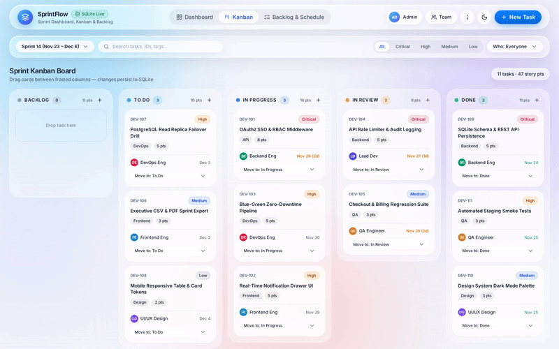
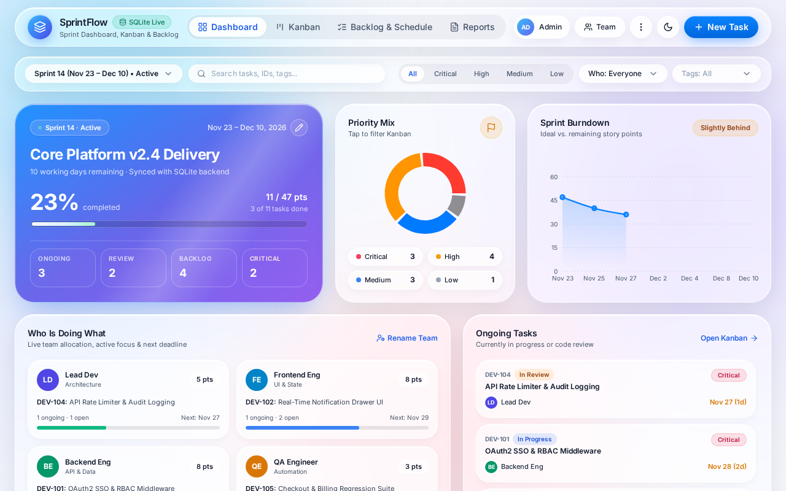
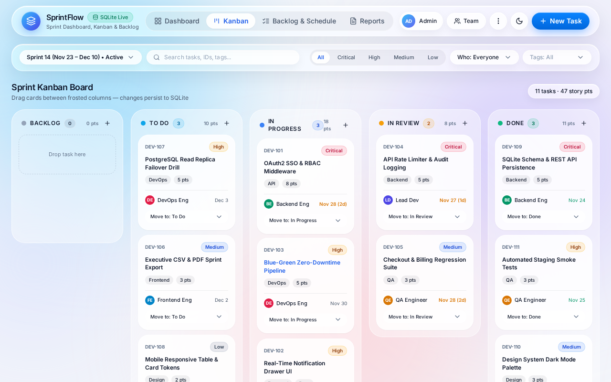
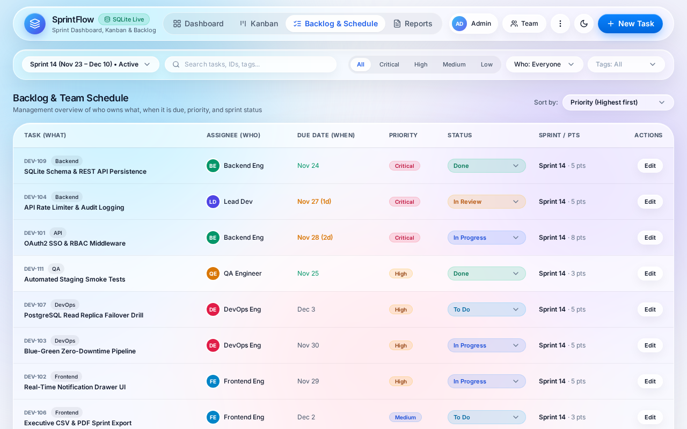
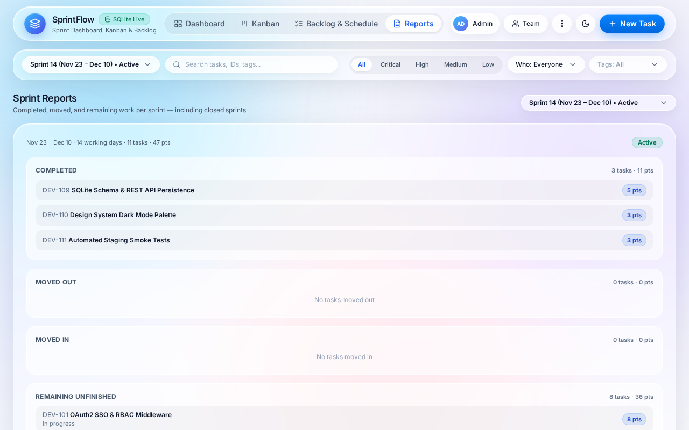

# SprintFlow — Sprints Without the Bloat

[](https://github.com/shridhargsabat/sprintflow/actions/workflows/ci-cd.yml)
[](https://github.com/shridhargsabat/sprintflow/blob/main/LICENSE)
[](https://github.com/shridhargsabat/sprintflow/tree/main/backend)
[](https://github.com/shridhargsabat/sprintflow/tree/main/frontend)
[](https://github.com/shridhargsabat/sprintflow/blob/main/docker-compose.yml)

**Plan the sprint, drag the board, ship the release — a**
**lightweight sprint manager in FastAPI + SQLite + React.**

🌐 **Live app:**
[sprintflow.ai-automation-hub.tech](https://sprintflow.ai-automation-hub.tech)

🧪 **Live demo (sample data):**
[demo-sprintflow.ai-automation-hub.tech](https://demo-sprintflow.ai-automation-hub.tech)
— open it and click **Try the demo** on the login page. Every click
reseeds the sample board, so it is safe to explore freely.

[](https://sprintflow.ai-automation-hub.tech)

## ✨ Features

- 📊 **Dashboard** — per-sprint KPIs: velocity, WIP, completion
- 📉 **Burndown chart** — ideal vs. remaining story points
- 🗂️ **Drag-and-drop Kanban** — To Do → In Progress → Review → Done
- 📋 **Backlog & team schedule** — groom backlog, promote to sprint
- 📈 **Reports** — per-sprint completed / moved / remaining work
- 🔁 **Sprint close + rollover** — unfinished work moves forward
- 🧾 **Activity trail** — per-task history of every change
- 🧩 **Subtasks + related links** — break down and connect tasks
- 🏷️ **Tags** — label tasks, filter the board by tag
- 🔍 **Filters + search** — sprint, priority, assignee, tag, text
- 🔢 **Points scale** — admin-configurable story-point options
- 📅 **Working-day sprints** — lengths count Mon–Fri only
- 🔗 **Deep links** — hash routes (`#/kanban`, `#/reports`, …)
- 🌙 **Dark mode** — one-click toggle in the header
- 👥 **Team management** — full CRUD on members and capacity
- 🔐 **Auth + RBAC** — JWT login, admin / lead / member / viewer
- 🔄 **Import / reset** — JSON import and one-click sample reset
- 📖 **Auto API docs** — Swagger UI served by FastAPI at `/docs`

| View | Screenshot |
| ---- | ---------- |
| Dashboard |  |
| Kanban |  |
| Backlog |  |
| Reports |  |

## 🚀 5-Minute Quickstart

### 1. Backend — FastAPI + SQLite (port 8000)

```bash
cd backend
uv sync                              # runtime only — creates .venv in place
# uv sync --group dev                # with test tooling (pytest + httpx)
.venv/bin/uvicorn app:app --reload --port 8000
```

No `uv`? Fallback with pip:

```bash
python3 -m venv .venv
.venv/bin/pip install fastapi==0.133.0 "uvicorn[standard]==0.34.0" \
  pydantic==2.10.4 "pyjwt>=2.15.1" "bcrypt>=5.0.0"
```

- SQLite `backend/sprintflow.db` is created and seeded on first launch.
- Swagger UI: `http://127.0.0.1:8000/docs`

### 2. Frontend — React + Vite (port 5173)

In a second terminal:

```bash
cd frontend
npm install
npm run dev
```

Open `http://localhost:5173`. All `/api/*` requests proxy
to the backend on port `8000`.

### Try the demo (sample data, one click)

**No setup needed:** open
[demo-sprintflow.ai-automation-hub.tech](https://demo-sprintflow.ai-automation-hub.tech)
and click **Try the demo**. Each click resets that demo board to fresh
samples; the main app at `sprintflow.ai-automation-hub.tech` is separate.

**Run it locally:** with the backend running and
`SPRINTFLOW_ENABLE_DEMO=1` (already set in `.env.example` for compose;
for bare uvicorn run
`SPRINTFLOW_ENABLE_DEMO=1 .venv/bin/uvicorn app:app --port 8000`):

1. Open the app → click **Try the demo** on the login page.
2. The workspace reseeds fresh samples and signs you in as
   `demo@sprintflow.local` (`Demo123!`, admin).
3. Every demo login re-resets the board — your experiments never
   pollute the next look.

### 3. Docker (optional)

```bash
docker compose up -d --build
```

## 🛠️ Tech Stack

| Layer | Tech |
| ----- | ---- |
| Backend | Python 3.11+ · FastAPI 0.133 · Uvicorn · Pydantic 2 |
| Auth | PyJWT + bcrypt (JWT login, RBAC roles) |
| Database | SQLite (auto-created + seeded, zero config) |
| Frontend | React 18 · TypeScript · Vite 6 · Tailwind CSS 3 |
| API client | Typed fetch wrapper in `frontend/src/api.ts`, `/api` proxy |
| DevOps | `uv` + npm · Docker Compose · GitHub Actions → GHCR |

## 📁 Project Structure

```text
sprintflow/
├── backend/
│   ├── app.py              # FastAPI app + CORS + /api/health
│   ├── auth.py             # JWT + RBAC (SPRINTFLOW_JWT_SECRET)
│   ├── db.py               # SQLite schema, auto-seeding, CRUD (SPRINTFLOW_DB_PATH)
│   ├── models.py           # Pydantic payloads
│   ├── routers/  # auth, tasks, team, users, board, settings, sprints, tags
│   ├── tests/              # pytest suite (httpx)
│   └── pyproject.toml      # uv-managed deps + uv.lock
├── frontend/
│   ├── index.html
│   ├── package.json        # build = tsc + vite build
│   ├── vite.config.ts      # Proxies /api -> http://127.0.0.1:8000
│   ├── nginx.conf          # Prod: /api proxy + SPA fallback (port 8080)
│   └── src/
│       ├── api.ts          # Typed fetch client for FastAPI endpoints
│       ├── App.tsx         # Auth gate + lazy BoardApp shell
│       ├── BoardApp.tsx    # Dashboard, Kanban, Backlog, Reports views
│       ├── views/          # Dashboard, Kanban, Backlog, Reports views
│       ├── components/     # UI components
│       └── auth/           # Auth provider + guards
├── docker-compose.yml      # backend + frontend + traefik labels
└── scripts/build-deploy.sh # CI deploy: ghcr build+push, compose up, smoke
```

## 🔌 Key REST Endpoints

- `POST /api/auth/login` · `GET /api/auth/me` — JWT session
- `GET /api/tasks` · `POST /api/tasks` · `PUT /api/tasks/{id}`
- `DELETE /api/tasks/{id}` · `PATCH /api/tasks/{id}/status`
- `POST /api/tasks/{id}/promote` — pull backlog task into sprint
- `GET /api/tasks/{id}/activity` — per-task activity trail
- `POST /api/tasks/{id}/links` · `DELETE /api/tasks/{id}/links/{n}`
- `POST /api/tasks/{id}/children` — create a subtask
- `GET /api/team` · `POST /api/team` · `PUT /api/team/{id}`
- `DELETE /api/team/{id}` — team member CRUD
- `GET /api/sprints` · `POST /api/sprints` · `PUT /api/sprints/{id}`
- `POST /api/sprints/{id}/activate` · `POST /api/sprints/{id}/close`
- `POST /api/sprints/{id}/rollover` — move unfinished work forward
- `GET /api/sprints/{id}/report` — per-sprint report
- `GET /api/tags` · `POST /api/tags` · `PUT /api/tags/{id}`
- `DELETE /api/tags/{id}` — tag master CRUD
- `GET /api/users/directory` — assignable users list
- `GET /api/settings/points-scale` · `PUT /api/settings/points-scale`
- `GET /api/dashboard/summary?sprint=Sprint%2014` — sprint KPIs
- `POST /api/import` · `POST /api/reset` — JSON import & reset

## 🗺️ Roadmap

- [x] Dashboard, Kanban, backlog, team CRUD, auth + RBAC
- [x] Burndown chart, filters, search, tags, dark mode
- [x] Reports view, sprint close + rollover, hash-route deep links
- [ ] Up next is tracked on the [issue tracker][issues].

## 🤝 Contributing

Issues and PRs welcome on the [issue tracker][issues].

## 📄 License

MIT — see [LICENSE](https://github.com/shridhargsabat/sprintflow/blob/main/LICENSE).

[issues]: https://github.com/shridhargsabat/sprintflow/issues
